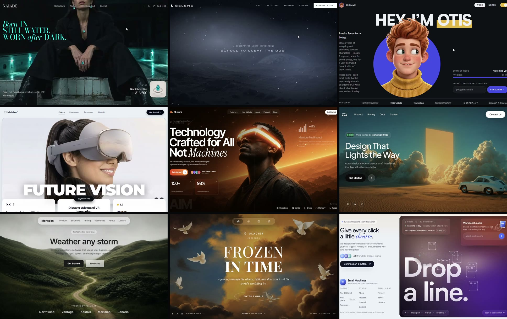

# Scrolltide scroll builder

**A free Claude skill for websites that do something when you scroll.**

Ask Claude for a landing page and you usually get a document: sections stacked, things fading in.
The pages people share have one moment the scroll performs: a camera that moves as you scroll, a scene
that parts, a route that draws itself. This skill builds those, starting from the **complete source of
real, shipped Scrolltide builds**, not a description of one.


<sub>The nine builds that ship with the skill. Top row: NAÏADE, SELENE, Otis. Middle: Visor, Fluxora, Aurora. Bottom: Monsoon, Glacier, Drop a Line.</sub>

## What Claude does with it

1. **Settles the brief** and names the page's scroll moment in one sentence.
2. **Picks a starting build** from the free shelf, the closest in scroll moment and shape.
3. **Gets that build running first**: the real source, its assets downloaded into your project.
4. **Makes it yours**: your words, your palette and type in Scrolltide's house style, your media.
5. **Checks it down the whole scroll**: screenshots at 0, 25, 50, 75 and 100% on a desktop and a
   phone, plus a report on errors, sideways scroll, fonts, video and hotlinked assets, then fixes
   what it finds.
6. **Hands over** the project, the shots, and what to replace before you ship.

It can also write a prompt instead of code: the full source of a build with your brand already in it,
ready for Lovable, Bolt, v0, Cursor or Windsurf.

## What's inside

- **Nine free builds** (`library/`): the complete source of real projects, byte-identical to the
  Scrolltide library. A 481-frame scroll film storefront, a six-layer parallax expedition site, a
  stretchable WebGL face, five cinematic heroes and a WebGL contact footer.
- **The house style** (`house-style.md`): grounds, accent, type, shape, motion and scroll lengths,
  **measured from 317 published Scrolltide builds**, not made up.
- **Scroll patterns** (`patterns/`): working vanilla code for the single scroll loop, frame-sequence
  films with speed ramps, layered stages, self-drawing paths, sideways reels, type moves, reveals and
  video heroes.
- **Checkpoint screenshots** (`scripts/scrollshot.mjs`): Node + Playwright. It flags a pinned stage
  that stops moving between checkpoints, so a broken scroll scene can't pass on a good first screen.
- **Hand-off notes** (`handoff.md`): full-source prompts for other AI builders.

## Install

**Claude Code, as a plugin**

```
/plugin marketplace add scrolltide/ai-studio-skill
/plugin install scrolltide-scroll-builder@scrolltide
```

**Claude Code, by hand.** Copy `plugins/scrolltide-scroll-builder/skills/scrolltide-scroll-builder` into
`~/.claude/skills/` (every project) or `.claude/skills/` (one project).

**Claude.ai and the desktop app.** Download `scrolltide-scroll-builder.zip` from the latest release, then
Customize → Skills → Upload a skill. Code execution needs to be on.

**For the screenshots**, once per project:

```
npm i -D playwright && npx playwright install chromium
```

## Try it

- *"Build a landing page for a watchmaker in Geneva. Scrolling should move the camera from the
  workshop bench into the movement."*
- *"A one-page site for a trail-running race, with the course drawing itself as you scroll."*
- *"Make my portfolio hero feel less like a template."*
- *"Write a Lovable prompt for a scroll storefront for my ceramics studio."*

## The free shelf

| Build | Scroll moment | Page |
|---|---|---|
| NAÏADE | A 481-frame film played by the scrollbar, product cards on the holds | [scrolltide.co/templates/naiade](https://www.scrolltide.co/templates/naiade?utm_source=github&utm_medium=readme&utm_campaign=scroll-builder) |
| SELENE | Six layers part to an earthrise; a route draws itself; a reel slides past | [scrolltide.co/templates/selene](https://www.scrolltide.co/templates/selene?utm_source=github&utm_medium=readme&utm_campaign=scroll-builder) |
| Otis | Grab a cartoon face and pull it like taffy (WebGL2) | [scrolltide.co/templates/otis](https://www.scrolltide.co/templates/otis?utm_source=github&utm_medium=readme&utm_campaign=scroll-builder) |
| Visor | Giant type split around a headset film, fanned cards | [scrolltide.co/templates/visor](https://www.scrolltide.co/templates/visor?utm_source=github&utm_medium=readme&utm_campaign=scroll-builder) |
| Fluxora | Ember agency hero, one italic serif word | [scrolltide.co/templates/fluxora](https://www.scrolltide.co/templates/fluxora?utm_source=github&utm_medium=readme&utm_campaign=scroll-builder) |
| Aurora | Dark film hero, copy anchored bottom-left | [scrolltide.co/templates/aurora](https://www.scrolltide.co/templates/aurora?utm_source=github&utm_medium=readme&utm_campaign=scroll-builder) |
| Monsoon | Bright misty film, dark type, frosted nav | [scrolltide.co/templates/monsoon](https://www.scrolltide.co/templates/monsoon?utm_source=github&utm_medium=readme&utm_campaign=scroll-builder) |
| Glacier | Exhibition-poster hero with a glass dock | [scrolltide.co/templates/glacier](https://www.scrolltide.co/templates/glacier?utm_source=github&utm_medium=readme&utm_campaign=scroll-builder) |
| Drop a Line | WebGL mesh-gradient contact footer | [scrolltide.co/sections](https://www.scrolltide.co/sections?utm_source=github&utm_medium=readme&utm_campaign=scroll-builder#s-drop-a-line) |

## More builds

These nine are the free shelf of the [Scrolltide library](https://www.scrolltide.co/?utm_source=github&utm_medium=readme&utm_campaign=scroll-builder&utm_content=more),
which has 370+ templates, sections, components, UI screens and shaders written the same way. On the
Yearly and Lifetime plans, the [Scrolltide MCP](https://www.scrolltide.co/mcp?utm_source=github&utm_medium=readme&utm_campaign=scroll-builder&utm_content=more)
lets Claude search the whole library and pull a build straight into your project; this skill uses it
automatically when it's connected.

## Licence

The skill's instructions, house style, patterns and scripts are MIT. The library builds and the
assets they download are © Scrolltide: use them for your own and your clients' websites, but don't
redistribute them as templates. Details in [LICENSE](LICENSE).
